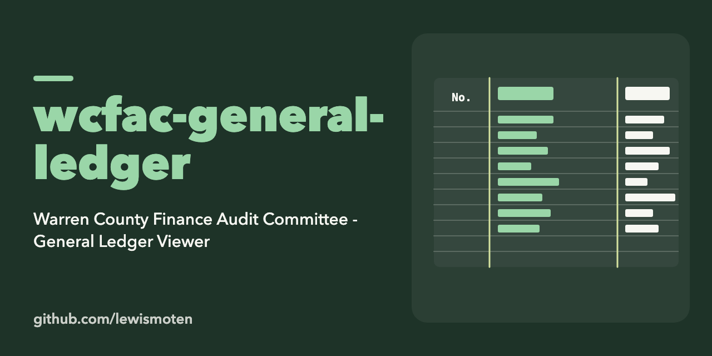

# WCFAC General Ledger

A viewer for the Warren County Finance Audit Committee general ledger. It is a React, TypeScript and Vite app (Material UI) with reports for department and function summaries, vendor concentration and large payments, and a financial health snapshot. A PHP API and SQL scripts in `host/` serve the ledger data.

```sh
npm install
npm start
```

Other scripts are listed in `package.json` (`npm run build`, `npm run lint`, and the data converters used below).

## License

ISC. See [LICENSE.md](LICENSE.md).

## Chart of Accounts

1. Locate all Chart of Account PDF files:

Files:
- MAJORS (DEPARTMENTS).pdf
- FUND NUMBERS.pdf
- ACCOUNTS (OBJECTS).pdf

2. Copy the text of the full document into corresponding txt files in `./data/chart-of-accounts/`.
- departments.txt
- funds.txt
- accounts.txt

3. Remove all page headers such as:
```js
11/07/2025 *GL065B* G/L CHART OF ACCOUNTS PAGE 1
WARREN COUNTY
Major# Description
------- -----------
```

4. Run a script to convert all text files to JSON
```bash
npm run convert-chart-of-accounts
```
